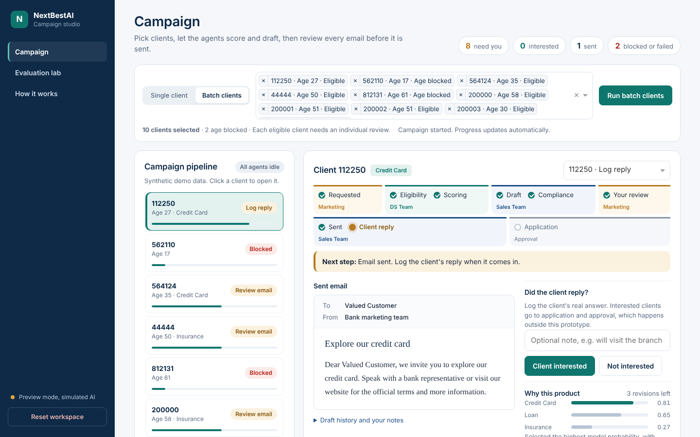
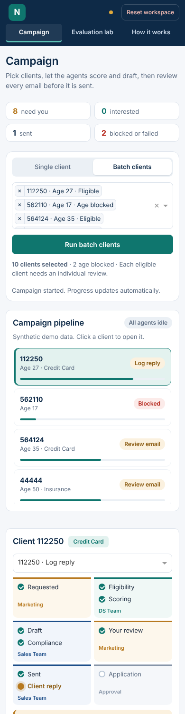
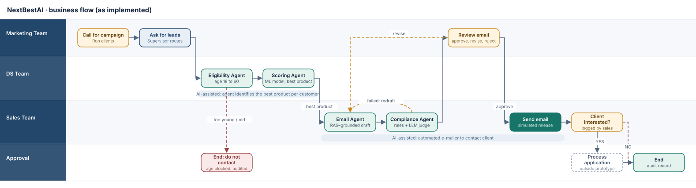
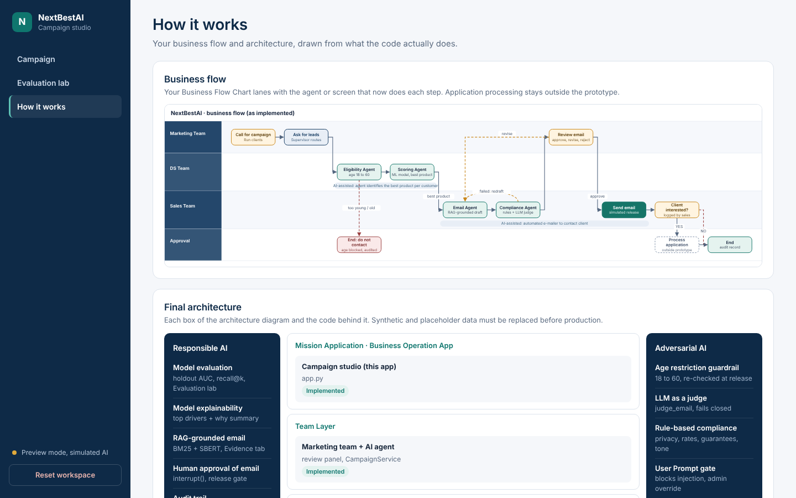
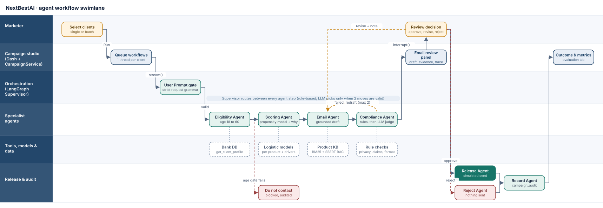

# NextBestAI Campaign Studio

A web dashboard for the NextBestAI multi-agent workflow, built with Plotly Dash on top of LangGraph. For each bank customer, the agents check eligibility, pick the best product, draft a grounded marketing email and check it for compliance. A marketer then approves, revises or rejects every email before it is sent.

The agents are defined in `../NextBestAI_FINAL.ipynb`, which serves as the single source of truth. `backend.py` loads the notebook's definitions and adds guardrails around them.

## Interface



<p align="center"></p>

| Area | Description |
|---|---|
| Navigation | A sidebar with three pages: Campaign, Evaluation lab and How it works. |
| Campaign pipeline | Lists every client in the run with its current step, product scores and status. The first client that needs attention opens automatically. |
| Journey rail | Shows where a client is in the business flow (Marketing, DS Team, Sales Team, Approval), with a Next step line that says what to do. |
| Email review | The draft is shown as a letter, next to the selected product, the score for each product, the reason for the recommendation and a compliance checklist. |
| Decisions | Approve and send, Revise with a note (up to 3 times), or Reject. Approval is only possible when the compliance check passes. |
| Client reply | After an email is sent, the marketer records whether the client is interested. |
| Workflow details | A live swimlane of the client's path through the agents, plus the evidence used, the full agent trace and the time each step took. |
| Evaluation lab | Live agent and red-team tests, ranking metrics on unseen holdout clients, saved reports and JSON download. |
| Responsive design | Works on desktop, tablet and phone, with visible keyboard focus and support for reduced-motion settings. |

## Business Flow Chart



| Step | Handled by |
|---|---|
| Call for campaign | The marketer selects one client or a batch and starts the run. |
| Ask for leads | The Supervisor routes each client to the agents. |
| Identify eligible clients | The Eligibility Agent applies the 18 to 60 age policy. Blocked clients are recorded and never contacted. |
| Create the model and predict leads | The Scoring Agent uses one logistic regression per product to pick the best offer and explain why. |
| Contact the client | The Email Agent drafts the email from approved product documents, the Compliance Agent checks it, and the marketer approves it before a simulated send. |
| Client interested? | The marketer records the client's reply. |
| Process application and approval | Interested clients are handed over to application and approval, which is outside the prototype. |

## Final Architecture



| Layer | Implementation |
|---|---|
| Mission application and business operation app | Campaign studio (this dashboard) |
| Team layer | Marketing team working with the AI agents through the review workspace |
| Agentic AI orchestration | Ollama (`qwen3.5:4b`), LangGraph, LangChain, Python |
| Agentic AI layer | Eligibility Agent, Scoring Agent, Email Agent, Compliance Agent |
| Data layer | Customer transaction data (synthetic), marketing guidelines and bank policies (placeholder documents) |

| Responsible AI | Adversarial AI |
|---|---|
| Model evaluation with holdout AUC and recall@k | Age restriction guardrail, checked again before release |
| Explainable scores with the top drivers for each product | LLM as a judge for email quality, which fails closed |
| RAG-grounded emails using BM25 and SBERT retrieval | Rule-based compliance checks for format, privacy, rates, guarantees and tone |
| Human approval of every email | Request gate that blocks prompt injection and false authority claims |
| Audit trail of every decision, archived rather than deleted | Red-team test suite |

### Agent workflow

The Supervisor routes each client through the agents using fixed business rules, so the LLM cannot skip the age gate, the compliance check or the marketer's approval.



### Other details

- Each client in a batch runs on its own, so one failed model call does not stop the others.
- Client replies are saved to a `client_responses` table and are always entered by a person.
- A `/health` endpoint supports monitoring, and the host, port, refresh interval, time zone and session secret can be set with environment variables.

## Installation

Run these from the folder that contains `NextBestAI_FINAL.ipynb` and `dashboard_draft/`. Python 3.11 or newer is required.

```powershell
python -m venv .venv
.\.venv\Scripts\Activate.ps1
python -m pip install -r dashboard_draft\requirements.txt
```

For live mode, install the live dependencies and the model. CPU PyTorch keeps the download small.

```powershell
python -m pip install torch --index-url https://download.pytorch.org/whl/cpu
python -m pip install -r dashboard_draft\requirements-live.txt
ollama pull qwen3.5:4b
```

## Run

```powershell
# Demo mode: simulated AI responses, no Ollama needed
python dashboard_draft\app.py --mode demo

# Live mode: real model calls through Ollama
python dashboard_draft\app.py --mode live
```

Open http://127.0.0.1:8117 in your browser.

## Testing

```powershell
python -m unittest discover -s dashboard_draft -p "test_*.py" -v
```

The tests run the real LangGraph workflow with simulated model responses. They cover the compliance rules, held drafts, batch failures, the audit archive, the swimlane, the client reply step, the health check and the app pages. `verify_live.py` and `verify_filtering.py` are optional checks that need Ollama running.

## Files

| File | Purpose |
|---|---|
| `app.py` | Dash user interface |
| `backend.py` | Notebook loader, structured email generation, compliance rules, `CampaignService` |
| `swimlane.py` | SVG swimlane renderer for the live and static diagrams |
| `evaluation.py` | Saved agent, red-team and ranking evaluations |
| `assets/` | `style.css`, `swimlane.svg`, `business_flow.svg` and README screenshots |

## Notes

- Customer data is synthetic and the product documents are placeholders. Emails are simulated sends.
- The `runtime/` folder holds the session secret, databases and model cache. It is listed in `.gitignore` and is recreated on first run, so it should not be committed or shared.
